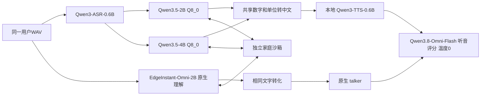

# HomeVoiceBench-ZH

中文家庭语音交互基准：**50个场景、1,000道题，每题最多5轮用户语音**。600道工具题测听懂后是否正确执行，400道聊天题测连贯、诚实、自然的交流。

参考 [RoleCraft-ZH](https://github.com/1zhou-Wang/RoleCraft-ZH) 的场景组织与模型比较思路，重新构建家庭环境、工具沙箱和测试题。不是原仓库的官方扩展，未复用其测试题。

当前记录状态：`complete`。数据集已冻结，实际运行和判官覆盖率见 [结果](docs/RESULTS.md)。冻结表示机器校验和哈希固定，不表示人工审题。

## 入口

- [交互讲解网页](docs/index.html)：下载后双击HTML，浏览50场景、1000题、链路图和真实语音。

- [在线讲解网页](https://09osd09osd.github.io/HomeVoiceBench-ZH/docs/index.html)。
- [完整数据和测评证据下载](https://github.com/09osd09osd/HomeVoiceBench-ZH/releases/tag/v0.2.0)。
- [Excel总览](outputs/homevoicebench-20261117/HomeVoiceBench-ZH.xlsx)。
- [数据生成](docs/DATASET.md)、[50场景目录](docs/SCENARIOS.md)、[完整工具沙箱](docs/SANDBOX.md)、[评分标准](docs/EVALUATION.md)。
- [字段字典](docs/FIELDS.md)、[运行复现](docs/REPRODUCIBILITY.md)、[来源与限制](docs/PROVENANCE.md)。
- [数字与单位朗读转换](docs/SPEECH_NORMALIZATION.md)、[交付包与解压说明](docs/DELIVERY.md)。
- 完整示例：[工具T06_003](data/cases/T06_003.json)、[聊天C03_003](data/cases/C03_003.json)。示例在正式结果出来前固定选定。

## 三条被测链路

原稿只用于合成语音和任务真值，不作为用户文字输入传给模型。级联系统的文字来自真实ASR。三条系统朗读前使用 `zh_spoken_v1`，如 `122 → 一百二十二`、`26℃ → 二十六摄氏度`；工具参数保持数值。

`data/cases/` 是1000题，`data/audio/` 是输入音频元数据，`data/manifest.json` 是冻结哈希，`spec/` 是工具及字段合同，`homevoice/` 是执行器，`scripts/` 是批处理管线，`tests/` 是测试，`reports/` 是真实结果，`docs/` 是讲解资料。

完整音频、逐题运行和判官原始响应已打包到本地release_parts，发布时作为Release资产分发；按归档内相对路径解压到仓库根目录。实际上传状态以 `reports/publication.json` 和交付说明为准。模型权重、API密钥和本机私有配置不进入仓库。
