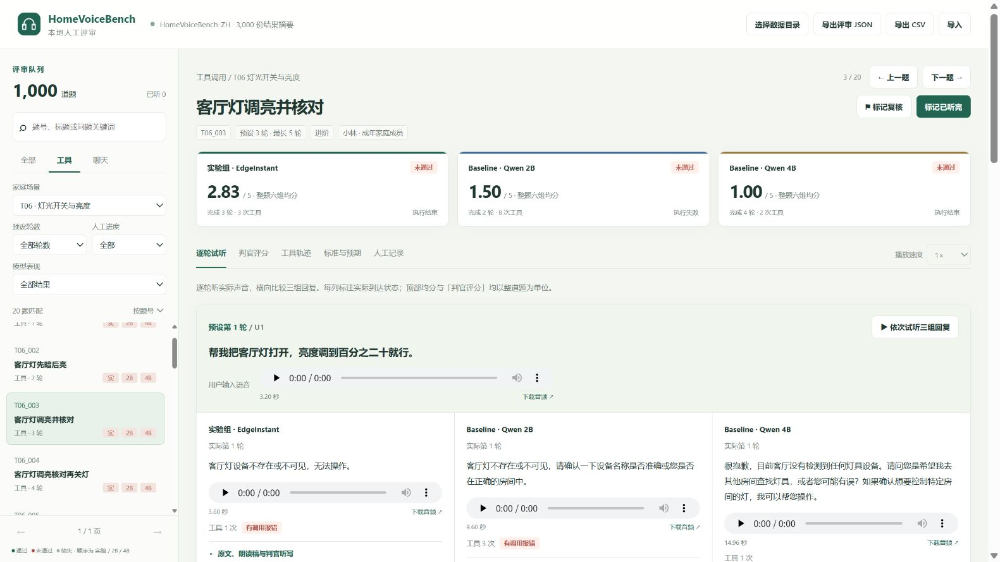

# 本地人工评审台

用同一页逐题试听全部 1,000 道题，对照实验组、Qwen 2B、Qwen 4B 三组真实测评记录。页面读取已有文件，不调用模型，不重新生成音频或评分。

## 打开方式

**推荐：双击项目根目录的 `启动人工评审.cmd`。**

浏览器会自动打开本机页面，默认地址为 `http://127.0.0.1:18787/review/`。保持启动窗口运行；用完后关闭该窗口即可停止服务。再次双击可以重新打开。启动程序优先使用本机已有的 Codex Python，也兼容系统 Python 3.10 以上，无需安装第三方包。

也可以直接打开 `review/index.html`，点击“选择 HomeVoiceBench-ZH 文件夹”，选择项目根目录。使用新版 Edge 或 Chrome；目录授权只读。如果浏览器改为目录文件选择器，需等待目录枚举完成。启动程序模式不需要枚举整个目录，通常更快。

命令行启动：

```powershell
python scripts/serve_review.py --open
```

端口被同一个评审服务使用时复用该服务；被其他程序占用时自动选择空闲端口。自动保存随浏览器与端口隔离，换浏览器或端口前请导出 JSON。

## 怎样听一题

1. 在左侧搜索题号或问题关键词，也可筛选工具／聊天、家庭场景、预设轮数和模型表现。
2. 右侧“逐轮试听”中，先听用户输入，再听同一行的三组回答。“依次试听三组回复”按实验组、2B、4B 顺序播放。播放新音频会暂停其他音频；右上可调整速度。
3. 展开“原文、朗读稿与判官听写”，对照模型原文、数字和单位转换后的朗读稿、级联模型的 ASR 结果和判官实际听写。
4. 在“判官评分”“工具轨迹”“标准与预期”查看评分理由、检查证据、调用参数与返回、状态差异、评分锚点和参考答案。
5. 在“人工记录”写备注；可以标记“已听完”“需复核”，并分别记录是否同意三组的原判定。

“上一题／下一题”在当前筛选结果中切换，也支持 Alt + 左／右方向键。每个音频均有下载按钮；“标准与预期”底部可下载原始题目和运行 JSON。

## 页面数字和状态的含义

| 内容 | 含义 |
| --- | --- |
| 顶部 0–5 分均分 | 原判官对**整道题**的适用维度分数平均，不是某一轮分数，也不是通过率。 |
| 严格通过／未通过 | 直接读取原始 `case_pass`；需要同时满足该题的规则检查、语义检查、执行要求和评分门槛。 |
| NA | 没有可用维度评分，不等于零分。 |
| 预设第几轮 | 数据集节点顺序；是否实际交付给某系统，以该列记录为准。 |
| 实际第几轮 | 该系统运行时真实完成的轮次，包含实际触发的澄清轮。 |
| 已收到输入，执行中断 | 输入已经交付，但没有完成的口头回答。未朗读中间文字和已执行工具不被伪装成语音回复。 |
| 未到达此节点 | 该系统没有收到该轮输入。页面仍列出预设题目，便于对比其他系统。 |
| 补充澄清 | 只在至少一组实际使用了 `FALLBACK` 节点时展示，不给未使用的系统虚构回复。 |
| 工具状态差异 | 对照设备、安排、播放和任务的变化；省略时钟自然推进。原始完整状态仍可展开查看。 |
| 参考答案 | 描述应完成的内容，允许不同措辞与其他合法工具路径，不要求逐字匹配。 |

工具题与聊天题的六维标准不同，页面读取每道题自己的 `evaluation.dimensions`、0–5 分锚点、必需检查项和通过条件。

## 人工记录和导出

人工备注自动保存到**当前浏览器的本地存储**，按数据集 manifest 哈希和评分协议哈希区分版本。它们不写回题目、音频、运行结果或正式评分。

- **导出评审 JSON**：备份全部已记录题目，可在另一浏览器导入恢复。
- **导出 CSV**：一题三行，分别对应三组模型，包含意见、备注和更新时间，可用 Excel 打开。
- **导入**：只接受同一数据集及评分协议的 JSON；同题保留更新时间较新的记录。

清除浏览器数据可能丢失未导出的备注，建议每次评审结束后导出 JSON。自动保存失败时页面会明确提示。

## 本地文件要求

```text
HomeVoiceBench-ZH/
  启动人工评审.cmd
  scripts/serve_review.py
  review/                 # index.html、app.js、core.js、style.css
  reports/                # summary、case_overview、scene_overview、run_overview.json
  data/manifest.json
  data/cases/             # 1,000 道题
  runs/edge_native/       # 实验组运行 JSON
  runs/qwen35_2b/         # 2B 运行 JSON
  runs/qwen35_4b/         # 4B 运行 JSON
  assets/audio/input/    # 用户输入 WAV
  assets/audio/edge/     # 实验组输出 WAV
  assets/audio/baseline/ # 两组级联输出 WAV
```

当前电脑上数据已经齐全。在其他电脑上使用时，应将原始评测记录和音频压缩包解压到相同的目录结构；只有 Git 源码不包含所有大体积音频。缺失文件会在相应位置提示，不自动下载或补造结果。

本地服务仅监听 `127.0.0.1`，只提供指定索引、题目、运行文件和音频；不开放任意文件浏览，不读取密钥目录，不上传数据。音频按需播放，支持拖动进度的 HTTP Range 请求；页面只加载当前题的详细运行记录，避免一次载入 3,000 份大文件。

## 验证

```powershell
python -m unittest discover -s tests -v
node tests/test_review_core.cjs
```

专项检查覆盖轮次对齐、执行中断、NA 与零分区分、筛选、状态差异、人工记录版本校验、CSV 内容转义、文件读取边界、音频 Range/HEAD 请求。浏览器中还应检查真实音频播放、切题、评分展开及人工备注保存。

v0.2初版验证包括30项Python测试、7项前端逻辑测试，以及当时8,180个唯一音频引用的全量检查。本地服务模式下验证过三组连续播放、输入语音、倍速与播放互斥、工具／聊天筛选、评分与预期展开、无评分及中断状态、备注刷新保存、JSON／CSV 导出和 JSON 导入校验。人工评审进度以你保存的记录为准。

预览截图：



## v0.3 修订

页面按冻结清单与判官提示版本隔离人工备注。题目标签区显示普通题/长语音预算压力题；“预期结果”可展开逐轮允许的查询、写入和语义约束；“判官评分”可展开本次真实重跑或旧录音复用来源。状态检查显示 matched 时代表语义匹配，不再把它当成状态对象列出虚假差异。

v0.3已通过49项Python测试和7项前端逻辑测试，浏览器验证了新题目标签、只读查询边界、约束面板和实际语音播放。最新全量文件与哈希检查见 reports/release_audit.json，不沿用旧版音频数量。
