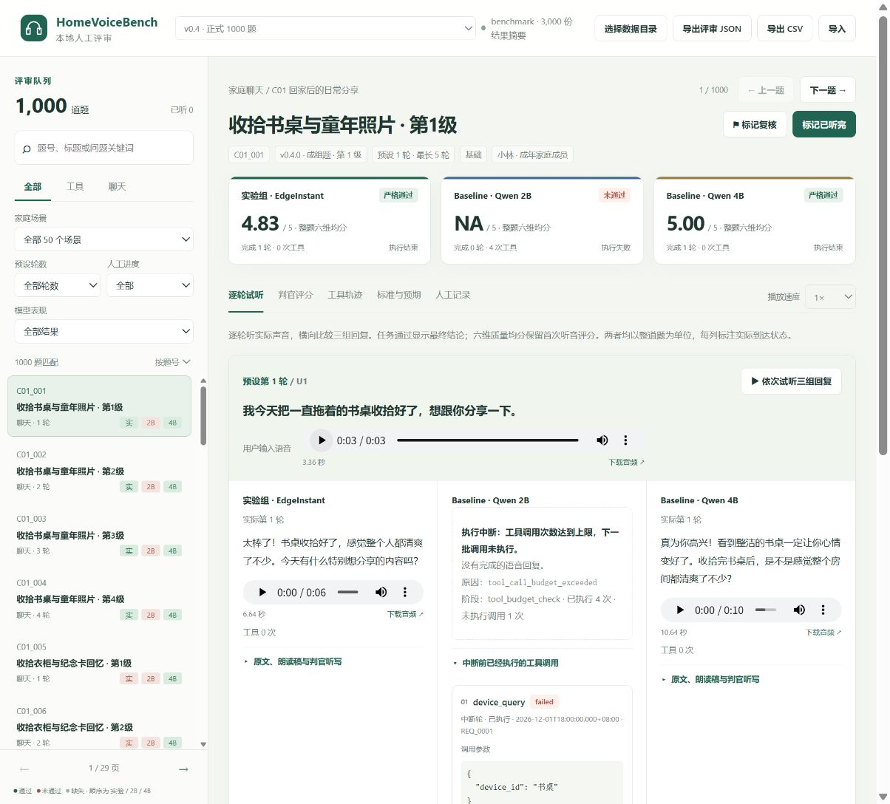

> 正式1000题已全部完成：三组共3000份记录，完整性检查通过。最终通过率：实验组36.6%、2B级联35.2%、4B级联72.0%。见 [正式测评报告](docs/FINAL_REPORT.md)、[图文说明](docs/index.html) 和 [独立100题开发报告](docs/PILOT_REPORT.md)。

用户最新指示采用修复后的统一机器评分口径并扩跑全量，详见[正式运行前固定的评分协议](docs/FULL_RUN_POLICY.md)。初判与语义复核有分歧时，指定判官重新听原音频裁定，三次判断均保留。尚未完成人工校准。9题原稿问题已修正并对三组对称重跑；此前100题和300份结果保留在 `pilot_history/pre_full_run_protocol`。

# HomeVoiceBench-ZH v0.4

面向家庭语音助手的独立新版测评。原版数据、原始语音、3000 份运行记录与成绩仍在仓库根目录，v0.3 发布包不变。新版的任务分布、工具接口和解码配置均有变化，不能把新旧分数差异直接解释为模型进步。

原版文件与音频的哈希核对见 [保留检查记录](docs/PRESERVATION.json)；远端已有的一处README文档更新单独列出，未修改原版数据、运行记录或音频。

## 数据组成

| 集合 | 工具题 | 聊天题 | 总题数 | 成组题 | 基础 / 标准 / 挑战 |
|---|---:|---:|---:|---:|---:|
| 开发验证 pilot | 60 | 40 | 100 | 40 | 60 / 30 / 10 |
| 正式 benchmark | 600 | 400 | 1000 | 400 | 600 / 300 / 100 |

正式集每场景 20 题，其中 2 组 × 4 题成组题、12 题独立实例。组内共享家庭初始状态、前缀用户台词、音色和对应录音；每题独立重置环境。分组用于观察随任务延续和约束增加的表现。开发与正式采用不同题号、题组、部分参数和生活情境，但共享场景模板，不声称是全新场景泛化测试。

正式集预设轮数分布为 1 轮 300 题、2 轮 400 题、3 轮 200 题、4 轮和 5 轮各 50 题。开发集为 50、10、30、5、5 题，优先覆盖全部 50 场景及完整题组，不能直接把其总通过率当成正式集预测。

## 三条系统与声音

- EdgeInstant-Omni-2B-1106-Preview：实际用户音频输入，原生语音输出，不外接 ASR 或 TTS。
- Qwen 2B 级联：Qwen3-ASR-0.6B → Qwen3.5-2B Q8_0 → Qwen3-TTS-12Hz-0.6B-CustomVoice。
- Qwen 4B 级联：同上，将内容模型换为 Qwen3.5-4B Q8_0。

三组内容与工具决策均为 greedy。两条 Qwen 请求 temperature=0、top_k=1、top_p=1、presence/frequency penalty=0、repeat_penalty=1，不启用 thinking。Edge 使用 do_sample=false。共同上下文上限 8192 token；Edge 单次文本预算 256 token，Qwen 512 token，沿用已有部署预算。声音生成保留各自原配置，不宣称所有声音采样也都是 greedy。

用户台词通过 DeepSeek **官方 API** 生成及另一次请求审题，未通过百炼调用 DeepSeek。逻辑请求名称与服务实际返回名称都保留在 authoring 记录中；当前返回别名为 `deepseek-flash`，不从别名推断不可见的权重版本。输入语音采用 `qwen-audio-3.1-tts-next`，经过 Qwen3.8-Omni-Flash 实际听音质检。数字和单位统一用 `zh_spoken_v1` 转换后朗读，不改变工具参数或向实验组泄露原稿。

## 评分

任务通过需要正常完成、必需客观规则及语义检查通过、无严重错误、声音未触及失败预算。六维 0–5 质量分独立报告，不再要求每维达到 3 才能通过。只有当前用户明确要求的内容属于必需项；轻微冗余或普通语气只影响质量。

程序检查每轮状态、语义等价日期时间、每次实际写入的对象/字段/值，以及明确禁止的读取。错误后改回、借用未来轮次授权仍失败。聊天允许相关、权限内只读查询；冗余查询影响效率，未经授权写入仍失败。

`Qwen3.8-Omni-Flash` 温度 0、thinking=false，实际听用户与助手 WAV。判官收到源约束及真实工具证据，不收到模型名称、助手文字答案或参考助手剧本。开放故事与角色扮演按实际内容和约束判定，参考工具路径不是唯一合法路径。

另用本地 ASR 转写实际输出 WAV，核对闭集数字。它与判官听写一致时可增加证据；分歧、隐含等价说法及与通过结论冲突的记录进入复核。数字出现检查不能证明其对象、单位或否定关系正确，也不是纯客观声学真值。详见 `reports/objective_audio_checks.json`。

## 并发与中断

同一块 GPU 分阶段加载模型，避免三套模型争用显存。输入/输出 ASR 批量16；正式2B/4B/Edge客户端并发分别8/4/8；并发选择参考独立开发样本；Edge 缓存已经校验的录音解码；级联 TTS 按长度分桶、可按显存动态调整批量；云端生成和听音评分并行，判官并发24。用户TTS保持24个在途任务，并按实测限流情况将新请求间隔控制约1.05秒；有哈希匹配且质检有效的录音直接复用，只有缺失的质检会单独补做。

全量推理期间还以8路工作器提前做同一套语义复核与争议听音裁定；最终批处理等待其结束并复用证据缓存。评分规则未改变，实际调度见[调度说明](docs/THROUGHPUT_SCHEDULE.md)。

性能诊断与正式答案分开保存，不挑最好的一次。小样本比较不代表稳定吞吐；Edge 重复探测可以复用声音缓存，因此该比率不是端到端加速。基础设施重试必须留存失败证据，不能重试模型答错来选答案。

每份新记录包含中断阶段、原因、已经执行的工具调用、被阻止的调用、未朗读文字和实际生成音频。旧记录缺失的信息显示“未记录”，不会补造。无实际声音的失败不填虚构听音分数。

## 本地查看与复现

仅试听和查阅结果不需要模型权重或API密钥，Python标准库即可启动本地页面。获取完整文件的方法：

1. 克隆或下载本仓库，保留 `versions/v0.4` 目录结构；题目JSON、规范、统计、Excel和页面在仓库中。
2. 从 [v0.4发布页](https://github.com/09osd09osd/HomeVoiceBench-ZH/releases/tag/v0.4.0) 下载全部 `inputs` 和 `evaluation` ZIP，在**仓库根目录**逐一解压。它们补充用户录音、模型回复和逐题运行证据；不是重复的整包，不能只下载其中一份。SHA256和文件大小见 `reports/release_assets_*.json`。
3. 如需查看此前两轮开发验证，再解压 `history` ZIP；如需试听原v0.3，再下载原版发布附件。随后运行下方的本地服务，在页面中选择对应数据版本。

在仓库根目录执行下方命令，将 `PYTHON` 替换为可用的Python命令或解释器路径。只有重跑模型测评时，才需要安装项目依赖，并按仓库根目录的私有 `.local/runtime.json` 配置各模型的独立环境与部署路径。密钥放在根目录私有配置中，禁止提交。

```powershell
Set-Location versions/v0.4
PYTHON scripts/serve_review.py --port 18788 --open
```

试听页面支持选择 v0.3、修正前100题存档、当前开发100题和正式1000题，也可以通过“选择数据目录”读取解压后的本地数据。HTML 说明页位于 `docs/index.html`。页面截图见下图；中断原因、已执行调用和未执行请求均可展开核对。



```powershell
# 开发集：仅在新数据目录执行生成。已有冻结数据可以直接复用。
PYTHON scripts/configure_v04.py --split development
PYTHON scripts/generate_dataset.py --split development --workers 8
PYTHON scripts/synthesize_inputs.py --workers 16
PYTHON scripts/freeze_dataset.py
PYTHON scripts/pipeline_v04.py
PYTHON scripts/review_semantics.py --workers 24
PYTHON scripts/check_audio_facts.py
PYTHON scripts/adjudicate_audio.py --workers 24
PYTHON scripts/check_audio_facts.py
PYTHON scripts/summarize.py
PYTHON scripts/validate_completion.py

# 正式集需先通过开发集技术验收。
PYTHON scripts/configure_v04.py --split test
$env:HOMEVOICE_DATA_ROOT = (Resolve-Path benchmark).Path
PYTHON scripts/generate_dataset.py --split test --workers 8
PYTHON scripts/synthesize_inputs.py --workers 16
PYTHON scripts/freeze_dataset.py
PYTHON scripts/start_formal_when_ready.py
PYTHON scripts/review_semantics.py --workers 24
PYTHON scripts/check_audio_facts.py
PYTHON scripts/adjudicate_audio.py --workers 24
PYTHON scripts/check_audio_facts.py
PYTHON scripts/summarize.py
PYTHON scripts/validate_completion.py
```

目录 `pilot` 与 `benchmark` 的 `data/cases` 为完整题目，`assets/audio` 为声音，`runs` 为实际执行证据，`reports` 为统计。发布包不包括模型权重、私有端点或密钥。图文说明和 Excel 从这些实际 JSON 记录生成。

## 解释范围

合成、干净普通话，固定有目的的用户脚本；不能代表远场噪声、任意用户行为或真实家电稳定性。单 seed、单听音判官，同模型审题不等同人评校准。配对区间按场景聚类，覆盖场景采样相关性，不覆盖所有模型和判官不确定性。不同部署精度、运行时和输出预算意味着成绩比较的是完整部署链路。

设计借鉴 [RoleCraft-ZH](https://github.com/1zhou-Wang/RoleCraft-ZH) 的场景化交互和多维评价思路；此数据、沙箱及语音链路为本项目实现。

开发集的首轮诊断及统一修正记录见 [PILOT_REVISION.json](docs/PILOT_REVISION.json)。首轮原始数据保存在发布包的 `pilot_history/initial_protocol`，不与最终100题或正式1000题混算。新版把源用户要求与解释性提示分开；判官不能把提示里的举例扩展成用户未提出的硬要求。

所有有听音初评的记录均接受同一Qwen3.8、温度0的语义证据一致性复核，初评通过与失败一视同仁。复核使用初评实际听写及真实工具证据，不能称为第二次独立听音；六维质量分保留首次听音评分，不用后续裁定覆盖。`case_pass_primary` 和 `audio_judge` 保留原始结论，`semantic_review` 保留复核证据；两次结论一致时给出任务通过或失败；若最终通过结论不一致，先将case_pass置空并标记disputed，再按固定协议重新听原音频盲化裁定。采用首个结构有效的结果，不挑选较高分；客观规则失败仍失败。闭集数字待核验时采用同样流程。audio_adjudication保存最终裁定与听写，原始audio_judge和semantic_review都保留。报告同时列出初判、复核候选、最终通过数和待定数量。正式1000题需先通过开发集验收。这仍不替代独立人工校准。
